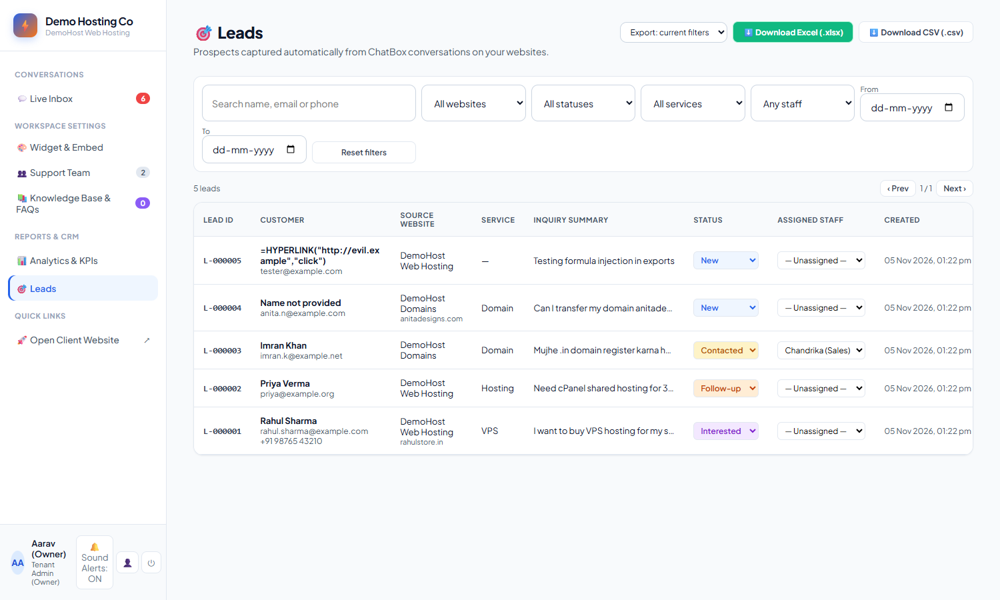
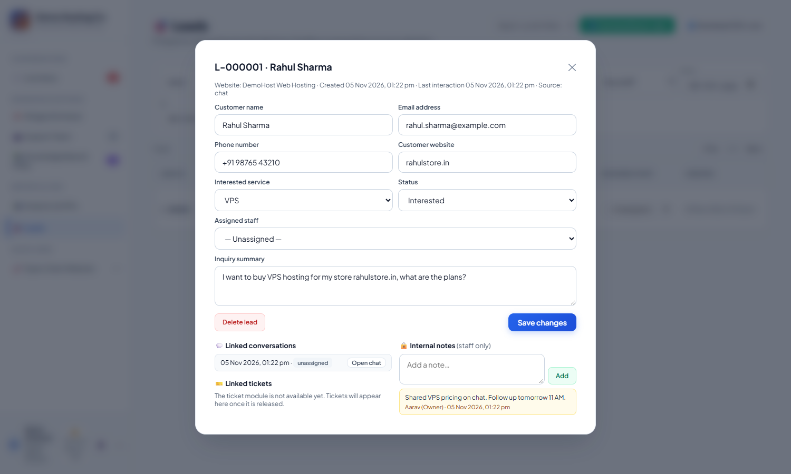
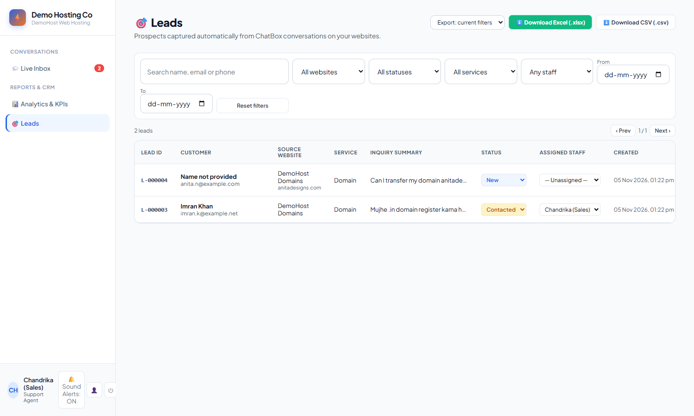

# ChatBox — Phase 3 Report: Audit Fixes + Leads Management

**Date:** 2026-11-05 (IST) **Environment:** local development only. No live server, live database or customer data was touched.
**Related:** [PHASE1_AUDIT.md](PHASE1_AUDIT.md) · [PHASE2_ARCHITECTURE.md](PHASE2_ARCHITECTURE.md) (cPanel-only revision, §15–16) · [CPANEL_DEPLOYMENT.md](CPANEL_DEPLOYMENT.md)

---

## सारांश (Hindi summary)

- Phase 1 audit की सभी 6 Critical और 10 High समस्याओं पर काम किया गया। 15 पूरी तरह ठीक हैं; H8 (visitor पहचान सिर्फ़ token से) Support PIN फीचर में पूरी तरह हल होगी।
- सभी 75 automated tests पास हो रहे हैं (पहले 17 fail थे)।
- नया **Leads** मेनू बना है: chat से leads अपने-आप बनते हैं, duplicate नहीं बनते, filters, notes, staff assignment, और **Excel (.xlsx) / CSV download** — सब company और website permission के साथ।
- कोड cPanel shared hosting पर चलता है (कोई Redis/Reverb/VPS ज़रूरी नहीं)।
- **आपको खुद करना है (section 8):** सभी passwords/keys बदलें, क्योंकि पुराने secrets git history में मौजूद हैं।

---

## 1. Test results (actual)

`php artisan test` on 2026-11-05, PHP 8.2.12, SQLite in-memory:

```
Tests:    75 passed (412 assertions)
```

| Suite | Tests | Result |
|---|---|---|
| Phase 1 audit regression tests (`Tests\Feature\Security\Phase1AuditTest`) | 16 | **16/16 pass** (were 16/16 failing) |
| Original suite (Auth, Dashboard, RealTimeChat, WidgetEmbed, Example ×2) | 17 | **17/17 pass** (`ExampleTest` was failing) |
| New Phase 3 security tests (`Phase3SecurityFixesTest`) | 22 | pass |
| New security helper unit tests (`SecurityHelpersTest`) | 5 | pass |
| New Leads tests (`LeadsManagementTest`) | 13 | pass |
| New lead detection unit tests (`LeadCaptureDetectionTest`) | 2 | pass |
| **Total** | **75** | **75 pass, 0 fail** |

One existing test was changed: `RealTimeChatTest::test_widget_init_returns_config_and_visitor_token` sent the domain only in a body `origin` field, which is exactly the H1 bypass. It now sends a real `Origin` header, as every browser does.

Also verified:
- The new migrations were run on a SQLite copy holding legacy rows, then rolled back and re-applied. Message sequence backfill and lead backfill were both checked.
- `node --check` passes for `public/widget.js` and the dashboard's inline script.
- A live browser run against a throwaway demo database ([screenshots](#6-screenshots)) reported no JavaScript errors.
- `composer audit` reports no advisories after the Symfony patch update.

---

## 2. Issues fixed

| ID | Issue | Fix | Proof |
|---|---|---|---|
| **C1** | Password reset with no token | Two-step reset with Laravel's password broker: an e-mailed single-use token that expires in 60 min. The same response is returned for known and unknown e-mails. On reset, all login tokens are revoked. Blade and Next.js screens updated. | audit test + `password_reset_full_flow…`, `forgot_password_response_does_not_reveal…` |
| **C2** | Stored XSS in dashboard → token theft | Visitor profile fields are stripped of markup on input. **Every** dashboard `innerHTML` sink and inline `onclick` argument now goes through `esc()` / `jsArg()` / `safeUrl()`. Toasts use `textContent`. The widget escapes FAQs, welcome text, department names and attachment links. | audit test; manual review of every remaining `${…}` |
| **C3** | Webhook secret returned by public widget API | `widget/init` returns an allow-listed `publicWidgetConfig()`. The secret moved to an encrypted, hidden column and is never sent to any browser (the dashboard only shows "saved"). | audit test + `secrets_are_visible_only_where_needed`, `saving_settings_with_blank_secret…` |
| **C4** | Uploads kept client extension; SVG/HTML served from app origin | Type comes from content sniffing (`finfo`) against an allow-list, and the extension from the sniffed type. Files go to `storage/app/private`. Downloads use **signed, expiring** URLs with `nosniff` + sandbox CSP. A message can only reference an attachment the sender uploaded. `public/uploads/attachments/.htaccess` neutralises legacy files. | 2 audit tests + 3 new tests |
| **C5** | SQL dump, scratch scripts, vendor/ reachable in root-docroot deploy | The root `.htaccess` now serves **only** files that exist in `public/`; everything else goes to Laravel (404). Dotfiles are blocked, plus a `FilesMatch` deny for sensitive extensions. `salutehost_chatbox.sql` is removed from git tracking (the file stays on disk), and `*.sql` is git-ignored. | Code review; Apache not available locally (see §9) |
| **C6** | Secrets / default passwords in repo | `.env.example` contains placeholders only. The shared `APP_KEY` was removed from the guide and the `password123` logins from README / EXPLAINED / Next.js. `chatbox:clean-accounts` now uses random passwords, refuses production without `--force`, and **no longer deletes every other user on the platform**. | `clean_accounts_command_keeps_real_users…`; secrets in **git history still need rotating** (§8) |
| **H1** | Domain whitelist bypass via body `origin` | Only the `Origin` header is trusted (`Referer` as fallback), now on **all** widget endpoints. Platform-created companies whitelist their own domain instead of `*`. | audit test + `wrong_origin_is_rejected_on_message_endpoints_too` |
| **H2** | Cross-tenant canned responses | Tenant scope is always applied; `property_id` only narrows it. | audit test + `agent_still_sees_own_tenant_canned_responses` |
| **H3** | Cross-tenant assign/transfer/department ids | Assignee must belong to the conversation's company. Departments must belong to the conversation's website, the agent's company, or the widget's website. | audit test + `cross_tenant_department_and_agent_references_are_rejected` |
| **H4** | SSRF via webhooks | `OutboundUrlGuard`: http/https only, ports 80/443/8080/8443, no credentials in the URL, every resolved IP must be public (private, loopback, link-local, CGNAT, metadata and IPv6 ULA ranges are blocked). The vetted IP is pinned (`CURLOPT_RESOLVE`) against DNS rebinding, and redirects are disabled. URLs are also validated when saved. | audit test + 2 unit tests + 2 feature tests |
| **H5** | Agents received `secret_key` | `secret_key` and webhook settings are hidden by default; only admins get them. | audit test + `secrets_are_visible_only_where_needed` |
| **H6** | No rate limiting | Every widget endpoint has a per-visitor **and** per-IP limit. Separate tight limits apply to init, messages/uploads and typing, plus a staff API limit and per-conversation/per-IP transcript limits. | audit test + transcript test |
| **H7** | Staff tokens never expire | `SANCTUM_EXPIRATION` defaults to 7 days. | `staff_tokens_expire` |
| **H8** | Visitor identity = bearer token only | **Partially.** The token format is enforced, rate limits apply and origins are checked. Verified, cross-device identity is the **Support PIN** feature (Step 5, next). | — |
| **H9** | Public attachments | Covered by the C4 fix: private storage and signed links. | C4 tests |
| **H10** | Transcript spam relay; false "success" | 3 per conversation per hour and 10 per IP per day. Success is reported only if the mailer accepted the message. The subject has CR/LF stripped. | `transcript_requests_are_rate_limited…` |
| **M1** | CSV formula injection | `Spreadsheet::cell()` prefixes `= + - @ TAB CR` cells with `'` (legacy and new exports). XLSX uses explicit text cells, so no live formulas. | audit test + 3 export tests |
| **M2** | Webhooks sent inside the visitor request | Sent after the response (`dispatch()->afterResponse()`, works on cPanel without a worker). | Code review |
| **M3** | No audit log | `audit_logs` table + `Audit::record()`. Logs login and failed login, password reset/change, agent create/update/delete, platform user changes, website create/update/delete, key regeneration, webhook tests, visitor block, lead updates/notes/deletes, and exports. Secrets are redacted. | `login_success_and_failure_are_audited`, export tests |
| **M4** | `CORS: *` on staff API | The widget API and attachment links keep `*`. The staff API only answers origins listed in `CHATBOX_DASHBOARD_ORIGINS`. Laravel's default CORS middleware is disabled (`config/cors.php`). | `cors_is_open_for_widget_but_not_for_staff_api` |
| **M5** | Unbounded `per_page`, filter after pagination | Capped at 100; status filtered in SQL. | Code review (superseded by `/leads`) |
| **M6** | Open self-registration without e-mail verification | Off by default (`CHATBOX_PUBLIC_REGISTRATION=false`). Super admins still create companies. | `self_registration_can_be_disabled` |
| **M7** | Unescaped transcript HTML | All values escaped; only http(s) attachment links. | Code review |
| **B1** | Bot greeting hard-coded "SaluteHost" | Uses the website name (or `widget_config.brand_name`). Brand stop-words are derived per website. | audit test |
| **B2** | Text HTML-encoded before storage | Stored as plain text; tags are still stripped as a safeguard. **Existing** messages are only flagged (`content_html_encoded`, content untouched) and decoded on display. | audit test + `legacy_html_encoded_messages_display…` |
| **B3** | Typing → HTTP 500 when realtime server down | All broadcasts wrapped (`safeBroadcast`). `.env.example` uses `BROADCAST_CONNECTION=null` for cPanel. | audit test |
| **B4** | Polling loses same-second messages | Per-conversation `seq` assigned under a row lock; sync uses `after_seq` (`after_id` still accepted for cached widgets). Existing messages are backfilled in display order. | audit test + `messages_get_strictly_increasing_sequence…` |
| **B5** | `data-property-key` embed didn't work | `widget.js` also reads `<script data-property-key>` and derives the API URL from the script. | Code review |
| **B6** | Overnight working hours broken | `isWithinHours()` supports ranges such as 22:00–06:00. | `operating_hours_support_overnight_ranges` |
| **B7** | `ExampleTest` failing; hard-coded home key | Home page uses `CHATBOX_DEMO_PROPERTY_KEY` or the first active website, and works before migration. | `ExampleTest` |
| **B8** | Guide seeded demo accounts / mismatched passwords | The guide now uses `chatbox:clean-accounts` (random passwords). | — |

### Additional defects found and fixed during the work

| Defect | Fix |
|---|---|
| `attachment_url` accepted any string, e.g. `javascript:…` in a link shown to staff | Only ChatBox-issued attachments are accepted; the dashboard and widget render only http(s) links. |
| `latestMessage` used `latestOfMany()` on UUID keys, so the inbox snippet showed a random message | Uses `ofMany('seq', 'max')`. |
| Deleting a lead in the old CRM deleted the **visitor and all their chats** (cascade) | The new `DELETE /leads/{id}` deletes only the lead record; chats are kept. |
| Inbox "Lead Stage" always showed NEW (read a field that does not exist) | Shows the linked lead's reference and status. |
| 8 Symfony security advisories (`composer audit`) | Patch-level update within Laravel 12 constraints; audit clean. |

---

## 3. Security changes in detail

| Area | Where |
|---|---|
| Output encoding | `resources/views/dashboard.blade.php` (`esc`, `jsArg`, `safeUrl`), `public/widget.js` (`esc`, `safeUrl`) |
| Input normalisation | `app/Support/SafeText.php` (messages: plain text minus tags; profile fields: no markup; URLs: http(s) only) |
| Widget origin checks | `app/Support/WidgetOrigin.php`, used by every widget endpoint |
| SSRF guard | `app/Support/OutboundUrlGuard.php`, `app/Services/WebhookService.php` |
| Private files | `app/Services/AttachmentService.php`, `app/Http/Controllers/Api/AttachmentController.php`, route `attachments.download` (signed) |
| Secrets | `Property::$hidden`, `toArray()` / `toArrayFor()` / `publicWidgetConfig()`, encrypted `webhook_secret` column |
| Rate limits | `app/Providers/AppServiceProvider.php`, `routes/api.php` |
| CORS / headers | `app/Http/Middleware/SecurityHeaders.php`, `config/cors.php` |
| Audit log | `app/Services/Audit.php`, `app/Models/AuditLog.php` |
| Formula injection | `app/Support/Spreadsheet.php`, `app/Services/LeadExporter.php` |
| Web server | `/.htaccess`, `public/uploads/attachments/.htaccess`, `.gitignore` |
| Configuration | `config/chatbox.php`, `.env.example`, `config/sanctum.php` |

---

## 4. Migrations (all additive)

| File | What it does | Touches existing rows? |
|---|---|---|
| `2026_11_05_100000_add_message_sequence_for_reliable_sync` | `messages.seq`, `conversations.last_seq`, unique `(conversation_id, seq)` | Writes `seq`/`last_seq` (new columns) in current display order; message content unchanged |
| `2026_11_05_100100_create_attachments_table` | Private attachment registry | No |
| `2026_11_05_100200_create_audit_logs_table` | Audit log | No |
| `2026_11_05_100300_add_webhook_secret_to_properties` | Encrypted secret column | No (legacy secrets move when an admin next saves settings) |
| `2026_11_05_100400_flag_legacy_html_encoded_messages` | `messages.content_html_encoded` | Sets the new flag on existing rows; content unchanged |
| `2026_11_05_110000_create_leads_tables` | `leads`, `lead_notes`, `lead_conversation`, `property_user`, `tenants.lead_counter` | **Copies** CRM visitors into `leads`; visitors are not modified |

Every migration has a working `down()` (tested on SQLite). **Back up the database before running them in production.**

---

## 5. Leads Management

**Capture** (`app/Services/LeadCaptureService.php`)
- A lead is created when a visitor shares a name, e-mail or phone, or starts a chat. Anonymous page views are not leads.
- One lead per visitor identity (`leads.visitor_id` is unique). Repeat visits and new messages update `last_interaction_at`; they never create duplicates.
- **No unsafe merging:** two visitors with the same name or the same (unverified) e-mail stay separate leads.
- Only empty fields are filled automatically, so staff edits are never overwritten.
- Interested service and customer website are detected from the first inquiry (e.g. "VPS", "Domain"; `rahulstore.in`). E-mail domains are not mistaken for websites. An e-mail typed in chat fills an empty e-mail field.
- Failures are logged and never break the chat.

**Dashboard** (Blade, menu **🎯 Leads**)
- **Columns:** Lead ID (`L-000001`, per company), customer name, e-mail, phone, source website, customer website, service, inquiry summary, status, assigned staff, created, last interaction.
- **Search and filters:** search by name, e-mail or phone; filter by website, status, service, assignee (me / unassigned / person) and date range (IST).
- **Statuses:** New, Contacted, Interested, Follow-up, Converted, Closed. Old stages are mapped: qualified → Interested, lost → Closed.
- **Editing:** status and assignee can be changed inline in the table.
- **Detail view:** edit the lead's fields, add internal notes (staff only), see linked conversations with "Open chat", and the linked-tickets area (empty until the ticket module exists).

**Permissions** (server-side, `Lead::visibleTo()`)
- Company owners and admins see every website of their company.
- Agents with **no** website assignment see all company websites, which matches current behaviour.
- Agents assigned to websites (`property_ids` on `PUT /api/v1/agents/{id}`) see only those leads **and conversations**.
- A lead can only be assigned to staff of the same company who can access its website.
- Only admins can delete.
- The same scope applies to the list, detail, updates, notes and exports.

**Export:** `GET /api/v1/leads/export?format=xlsx|csv&scope=filtered|all`. It streams (low memory), uses IST timestamps and a UTF-8 BOM for CSV, neutralises formulas, is scoped to the company and website, and writes an audit entry with the filters and row count. XLSX is written with OpenSpout (pure PHP; needs `zip` + `xmlwriter`).

**API:**

| Method | Endpoint | Purpose |
|---|---|---|
| `GET` | `/leads` | List |
| `GET` | `/leads/meta` | Filter options |
| `GET` | `/leads/{id}` | Detail |
| `PUT` / `PATCH` / `POST` | `/leads/{id}` (`POST` form: `/leads/{id}/update`) | Update |
| `POST` | `/leads/{id}/notes` | Add an internal note |
| `DELETE` | `/leads/{id}` | Delete (admins only) |
| `GET` | `/leads/export` | CSV or XLSX download |

The old `/crm/leads*` endpoints remain for compatibility, now secured, and are superseded by `/leads`.

---

## 6. Screenshots

The screenshots come from a local run with a throwaway demo database. Leads were created by calling the real widget API as website visitors would.

| | |
|---|---|
|  | **Owner view:** 5 leads from two websites. The `=HYPERLINK(...)` test name renders as plain text (C2) and is exported as `'=HYPERLINK…` (M1). |
|  | **Lead detail:** auto-detected service (VPS) and website (`rahulstore.in`), internal note, linked conversation. |
|  | **Agent assigned only to "DemoHost Domains"** sees 2 leads; the Hosting leads are hidden by the server. Assigning a Hosting lead to this agent returned HTTP 422. |

---

## 7. Configuration example (no real secrets)

See `.env.example`. New keys:

```env
BROADCAST_CONNECTION=null          # cPanel: polling, no WebSocket server
SANCTUM_EXPIRATION=10080           # staff tokens: 7 days
CHATBOX_PUBLIC_REGISTRATION=false
CHATBOX_DASHBOARD_ORIGINS=         # e.g. http://localhost:3000 for the Next.js dev server
CHATBOX_ATTACHMENT_MAX_KB=10240
CHATBOX_ATTACHMENT_LINK_TTL=1440   # minutes a signed download link stays valid
CHATBOX_DEMO_PROPERTY_KEY=         # set to pk_live_chatbox_… to keep the current home-page widget
```

---

## 8. Actions required from you (cannot be done in code)

1. **Rotate every secret that was ever committed.** Earlier commits contain `.env.example` values, the shared `APP_KEY`, `salutehost_chatbox.sql` (password hashes, `secret_key`s, visitor PII) and published passwords. Untracking a file does not remove it from history. Rotate:
   - `APP_KEY` on every server. **Warning:** rotating it invalidates the encrypted `webhook_secret` values; re-enter them afterwards.
   - The database and mail passwords and the Reverb keys.
   - Every website `secret_key` (Regenerate Keys).
   - Every staff password, starting with the super admin.
2. If the repository was ever pushed to a shared or public remote, treat the dump's customer data as exposed and assess your obligations under the DPDP Act.
3. If a deployed copy exists: delete `salutehost_chatbox.sql` and `scratch/` from the server, and prefer the subdomain setup (document root = `public/`).
4. After deploying, staff whose tokens are older than 7 days will be asked to log in again.
5. The home page previously preferred the hard-coded key `pk_live_chatbox_FiTEeVrRTkfRAuGWIhjD`. Set `CHATBOX_DEMO_PROPERTY_KEY` to keep it.

---

## 9. Known limitations

- **Apache rules (C5) were not executed**: there is no Apache locally. Test after deployment: `https://<domain>/salutehost_chatbox.sql`, `/scratch/…`, `/vendor/autoload.php` and `/.env` must all return 403 or 404.
- **Tested on SQLite, not MySQL.** The migrations use portable schema calls; run them on a staging copy of the MySQL database first.
- **H8 is only partially addressed** until the Support PIN identity (Step 5) ships.
- The **Next.js dashboard** received only the credential and password-reset fixes. Leads, private uploads and the other new UI exist in the Blade dashboard, which remains the production UI until the planned consolidation.
- Staff tokens are still stored in `localStorage`. With output encoding fixed and expiry added, the risk is reduced; moving to HttpOnly cookie sessions is planned with the dashboard consolidation.
- **Legacy uploads** in `public/uploads/attachments` stay public but can no longer execute or render as HTML or SVG. A move to private storage can be done with a one-off command once you approve modifying existing data.
- **Signed attachment links** work for anyone holding the link until it expires (24 h in-app, 30 days in transcript e-mails).
- **Lead detection is keyword based.** Service and website guesses can be wrong, and staff can correct them. Phone numbers are not auto-extracted from free text.
- **Signup e-mail enumeration** (Support PIN, upcoming) remains as described in Phase 2 §3.5.

---

## 10. Next step (as instructed)

Step 5: website-specific admin login URLs, customer Support PIN (signup / login / OTP recovery), persistent chat and ticket history in the widget, ticket system with automatic escalation, Telegram notifications, AI knowledge base. Each step follows the Phase 2 plan and keeps the cPanel-only constraints.
